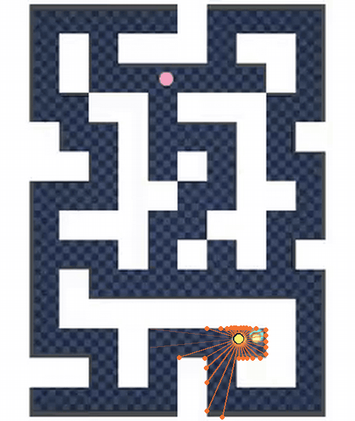
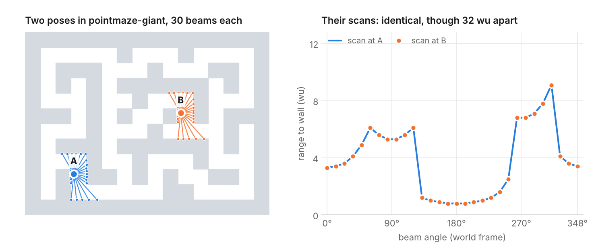
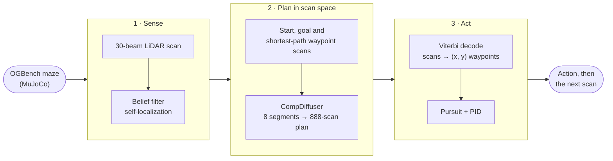
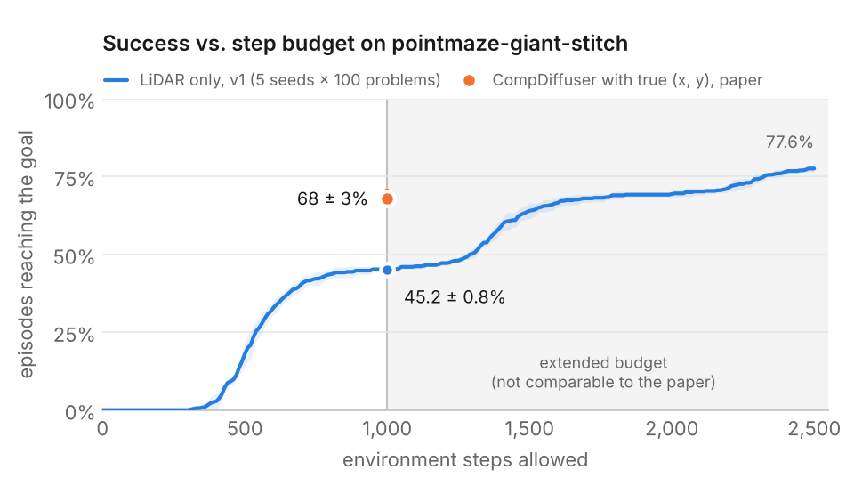
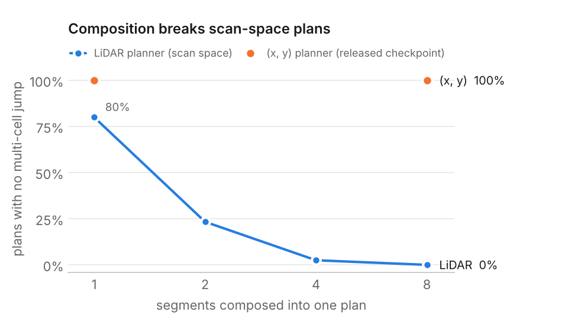

# CompDiffuser-LiDAR: Compositional Diffusion Planning from Range Scans

[[CompDiffuser paper]](https://arxiv.org/abs/2503.05153)
[[CompDiffuser code]](https://github.com/devinluo27/comp_diffuser_release)
[[CompDiffuser project page]](https://comp-diffuser.github.io/)
[[OGBench]](https://github.com/seohongpark/ogbench)

<!-- Authors and affiliations go here, in the same style as the CompDiffuser README, e.g.
[First Last](https://link)<sup>1</sup>, [First Last](https://link)<sup>1</sup>
<sup>1</sup>Affiliation -->

This repository extends [CompDiffuser](https://github.com/devinluo27/comp_diffuser_release) from planning
over the agent's true position to planning over what a robot actually measures: a **30-beam LiDAR scan**.
The diffusion planner is retrained from scratch on sequences of scans and **never receives (x, y)**;
in our main loop, every position the agent acts on is inferred from scans.

<p align="center">
  
</p>

**A LiDAR-only agent crossing `pointmaze-giant-stitch`.** The planner composes eight short diffusion
segments into one long plan, expressed entirely as range scans; a grid localizer turns that plan into
waypoints, and a filter tracks the ball from its live scan. Real rollout of our v1 agent (seed 0,
episode 76, success). The orange beams are re-cast from the ball's tracked position with the
repository's own ray-caster; cyan marks the start, pink the goal, and gray the path so far.

## 🔭 Overview

CompDiffuser ([Luo et al., 2025](https://arxiv.org/abs/2503.05153)) generates long-horizon plans by
composing short trajectory segments, each denoised while conditioned on its neighbours, so that a planner
trained only on short demonstrations can stitch them into routes across a maze. On OGBench it reaches
**68 ± 3%** on `pointmaze-giant-stitch` and **65 ± 3%** on `antmaze-giant-stitch`. In those experiments
the state the planner diffuses over is the agent's ground-truth (x, y).

A real robot does not get its coordinates; it gets sensor readings. **We replace the position with a
LiDAR scan and ask whether trajectory stitching still works, and where it breaks when it doesn't.**

- **Ball (point mass), LiDAR only: 45.2 ± 0.8%** on `pointmaze-giant-stitch` at OGBench's 1,000-step
  budget (5 seeds × 100 problems), against 68 ± 3% for CompDiffuser with the true (x, y).
- **Ant, without (x, y): 37%** on `antmaze-giant-stitch` (100 problems) with a scan-based grid navigator and an
  inverse-dynamics executor that never sees (x, y); with the diffusion planner in the loop, 5%. The ant
  runs use an extended budget (see [Results](#-results)).
- **The weak link is composition in scan space, not perception.** A single scan-space segment decodes into
  a clean path 80% of the time; none of 240 eight-segment plans does, while the same test on the (x, y)
  planner stays at 100%.

## 📡 How LiDAR enters navigation

### The sensor

The agent's position is replaced by **30 range beams spread over 360°**, ray-marched in 0.1 wu steps
against the maze's occupancy grid with OGBench's exact geometry (4 wu cells) and clipped at a maximum
range of 12 wu, three cells (24 wu in the history model). For the **ball** the scan is taken in the world
frame, since a point mass has no heading. For the **ant** the beams are cast in the body frame and rotate
with the torso's yaw, recovered from its quaternion, the way a car-mounted LiDAR would.

<p align="center">
  <picture>
    <source media="(prefers-color-scheme: dark)" srcset="media/lidar_sensor_aliasing_dark.png">
    
  </picture>
</p>

**What the planner sees.** Left: two poses in `pointmaze-giant` with their beams. Right: the 30-dimensional
vector each one produces, which is all the planner ever receives. A and B are 32 wu (eight cells) apart and
their scans are identical. Rendered with [`lidar_sim.py`](comp_diffuser_lidar_ball/diffuser/datasets/lidar/lidar_sim.py).

### Training on scans

- **Data.** Every transition of the OGBench `*-stitch` datasets is converted to a scan once and cached
  (about 85 s per million transitions). The scanner's geometry is checked against the datasets: every
  recorded position lies in a free cell, and hand-placed poses return exact distances.
- **Planner.** CompDiffuser's own denoiser and composition code, with a 30-D state instead of a 2-D one:
  horizon 160, 512 diffusion steps, trained from scratch for 2M steps. The network sizes itself from the
  dataset's state dimension; apart from v2's history encoder, the architecture is unchanged.
- **Compatibility.** The LiDAR paths switch on only when a config carries a `lidar_config`; the original
  (x, y) code paths are kept alongside them.

### Closing the loop

The v1 ball agent, the one behind the 45.2% result, runs this loop:



1. **Condition.** The current scan is inpainted at the first frame and the goal scan at the last. Each
   intermediate segment is also aimed at a scan rendered at a waypoint along the maze's shortest path
   (BFS) from the believed position to the goal.
2. **Plan.** CompDiffuser samples eight overlapping 160-frame segments (DDIM, 50 steps, guidance 2.0) and
   blends them into one 888-frame plan made of scans.
3. **Decode.** A localizer over a 0.5 wu grid of 4,409 poses picks the most likely *continuous path*
   through the whole plan (Viterbi, max-product). Decoding each frame on its own sent waypoints to
   look-alike places on the other side of the maze.
4. **Act.** A pursuit cursor aims 2 wu of plan arc ahead, with a line-of-sight check, and a PID drives the
   ball there. The PID is the upstream point-maze controller.
5. **Localize.** A histogram filter on the same grid tracks the ball from its live scan at every step;
   the same likelihood machinery locates the goal from the goal scan.

The ant (`antmaze-giant-stitch`) uses the same sensing and planning code with a different body:

| | Ball (point mass) | Ant (quadruped) |
|---|---|---|
| Scan frame | world frame | body frame (rotates with the torso) |
| Planner | scan-space CompDiffuser, 8 segments | scan-space CompDiffuser, 9 segments |
| Executor | pursuit + PID on decoded waypoints | learned inverse dynamics on [proprioception, scan]: predicts the next 16 actions toward a scan 12–20 steps ahead, plays 8, re-queries |
| Localization grid | 0.5 wu, one heading (4,409 poses) | 1 wu × 12 headings |
| Routing | diffusion plan → Viterbi decode | grid navigator (localize → BFS route → scans along the route), or diffusion toward grid-routed subgoals |

> [!NOTE]
> **What the agent knows.** No (x, y) ever enters the diffusion planner. The decoder, the localization
> filters, the shortest-path waypoints and the line-of-sight checks all use the known maze map, which
> CompDiffuser itself does not need. Our agent therefore has *more* task knowledge than the paper's,
> delivered through a sensor, and the numbers below are a reference point rather than a head-to-head win
> or loss.

## 🧩 Implementations

Each folder is a self-contained copy of the CompDiffuser release with one version of the LiDAR work, its
configs, scripts, tests, evaluation results and a write-up with the full details.

| Folder | Agent | What it adds |
|---|---|---|
| [`comp_diffuser_lidar_ant`](comp_diffuser_lidar_ant) | Ant | The first LiDAR port: ray-caster and dataset conversion, a scan-space planner trained from scratch, LiDAR inverse dynamics with and without (x, y), closed-loop rollout on an (x, y, θ) grid, the grid navigator, goal-cell ranking and verify-and-hop. Write-up: [`LIDAR_README.md`](comp_diffuser_lidar_ant/LIDAR_README.md) |
| [`comp_diffuser_lidar_ball`](comp_diffuser_lidar_ball) | Ball, **v1** | Formerly `comp_diffuser_ball`. Port to the point mass with world-frame scans, Viterbi plan decoding, the PID executor, the belief filter, the evaluation ladder and the analysis suite (ambiguity census, plan anatomy, decode gates, step-budget study). Write-up: [`BALL_README.md`](comp_diffuser_lidar_ball/BALL_README.md) |
| [`comp_diffuser_lidar_ball_hist`](comp_diffuser_lidar_ball_hist) | Ball, **v2** | Formerly `comp_diffuser_ball_v2`. A clean rebuild from the release with receding-horizon replanning and a scan-history encoder inside the denoiser (16 scans, range 24 wu), evaluated with pre-registered gates. Write-up: [`BALLV2.md`](comp_diffuser_lidar_ball_hist/BALLV2.md) |

## 📊 Results

| Agent | Method | Plans over | Steps | Success |
|---|---|---|---|---|
| Ball | CompDiffuser (paper) | true (x, y) | 1,000 | 68&nbsp;±&nbsp;3% |
| Ball | **v1**: scan-space CompDiffuser, Viterbi decode, PID | 30-beam scans | 1,000 | **45.2&nbsp;±&nbsp;0.8%** |
| Ball | v1, extended budget | 30-beam scans | 2,500 | 77.6&nbsp;±&nbsp;1.1% |
| Ball | v2: + 16-scan history, replanning every 100 steps | scans + history | 1,000 | 13&nbsp;/&nbsp;12&nbsp;/&nbsp;9% |
| Ant | grid navigator (no diffusion), inverse dynamics without (x, y) | grid route | 8,000 | 37% |
| Ant | grid navigator (no diffusion), orientation-agnostic goal ranking | grid route | 8,000 | 39% |
| Ant | scan-space CompDiffuser toward grid-routed subgoals | 30-beam scans | 8,000 | 5% |

Ball rows: 100 evaluation problems (5 tasks × 20) per seed; v1 over 5 seeds (mean ± sd), v2 per seed for 3
seeds. The v2 arm also steers toward the decoded goal cell once it is within 12 wu with a clear line of
sight, and replans early when the decoder's confidence drops. Ant rows: one seed × 100 problems with a
goal radius of 1.0 wu (the environment default is 0.5) and an 8,000-step budget, so they are not
comparable to the paper's 65 ± 3%. In the 39% run the inverse dynamics sees the full proprioceptive
state, which includes (x, y).
Per-episode records: [ant runs](comp_diffuser_lidar_ant/rollout_results),
[v1, 500 episodes](comp_diffuser_lidar_ball/logs/lidar_eval/ball_step_budget_viterbi.json),
[v2 best arm, with sample videos](comp_diffuser_lidar_ball_hist/logs/pointmaze-giant-stitch-v0/plans/ballv2_og_pntM_Gi_lidar30_r24_hist16_Cd_Stgl_PadBuf_Ft64_ts512_resume_H160_T512_LimitsNormalizer_b1_condFalse/0/261023-154611-128-nm100-ems1k-ncp8-interleave-evSd0-st0-belief-hist1-re100-sr13)).

<p align="center">
  <picture>
    <source media="(prefers-color-scheme: dark)" srcset="media/success_vs_budget_dark.png">
    
  </picture>
</p>

**Success keeps rising after 1,000 steps.** Success latches once the goal is reached, so the curve can
only climb; the shaded band is ±1 sd over 5 seeds. That it is still rising at 2,500 steps says many
1,000-step failures are slow rather than lost (see finding 4 below). Results past 1,000 steps are an
extended-budget ablation and are not compared with the paper.

## 🧭 Research direction

**The question.** Compositional diffusion planning stitches short segments into long plans by making
neighbouring segments agree on their overlap. Does that coupling survive when the state is a raw sensor
reading instead of a position? Five findings so far, each with the evidence behind it, and the steps
they point to:

**1. The sensor is ambiguous by construction.** In the giant maze, 64% of positions have a look-alike at
least 8 wu away that is closer in scan space than the point one 0.5 wu step away (4,409-pose census);
some pairs are exactly identical, as in the figure above. On the ant, whose scans also depend on heading, the
true goal cell was among the six most likely cells only about 45% of the time (99.5% for the ball), with
rooms that match the goal after a 90° turn as the main decoys. That is why we moved from the ant, stuck
near 10% with control, self-localization and goal ambiguity failing together, to the ball, where aliasing
is the only difficulty left.

**2. Single segments work; composition is the weak link.**

<p align="center">
  <picture>
    <source media="(prefers-color-scheme: dark)" srcset="media/composition_ladder_dark.png">
    
  </picture>
</p>

Offline test on start–goal pairs placed at the maze distance a plan of that length covers in the data,
240 sampled plans per point. A plan counts as clean when its decoded path never moves more than one cell
between consecutive frames. One 160-frame scan segment is clean 80% of the time; two, four and eight
composed segments give 23%, 2.5% and 0%. The released (x, y) planner stays at 100%.

The breaks sit where segments meet: in v2's composed plans, 93% of decoded jumps fall inside the segment
overlaps, which hold 44% of the frames, and two neighbouring segments decode their shared overlap a
median 25.7 wu (about six cells) apart. Part of the cause is the blend itself, because a weighted mean of two range vectors is a scan from
no pose: decoding each segment to (x, y) before blending cuts the jump rate about ninefold (2.4% → 0.26%
of frames), but the disagreement between segments remains.

**3. Decoding whole paths recovers much of the loss.** Replacing the per-frame decode with Viterbi over
the full plan removed every unreachable waypoint and, with no retraining, raised success at 1,000 steps
from 19% to 45.2%.

**4. Perception is not the bottleneck; lost time is.** An evaluation ladder that swaps in one
sensor-derived quantity at a time (2,500 steps, 3 seeds × 100 problems, earlier per-frame decoder) stayed
flat: 55% with the true position and goal, 55% with the goal located from its scan, 57% with the ball
also localized from its live scan. Meanwhile, during the first 1,000 steps the ball stands still 51% of
the time: 17.7% with the pursuit target sitting on the ball, 32.9% pinned against a wall while the
controller pushes. Counting only the steps in which it moves, 74.2% of episodes would arrive within
1,000 steps, an upper bound on what fixing the executor alone could buy.

**5. Scan history did not help the denoiser yet.** v2 adds an encoder over the last 16 observed scans. On
held-out windows it made the denoising error 8.9% *worse* (sign test, p ≈ 10⁻²⁵), and the best
receding-horizon arm reached 13 / 12 / 9%. Frequent replanning also exposes a second problem: each new
plan is decoded from scratch, so on an aliased maze it can start in a look-alike place, as if the ball had
teleported.

**Next steps, from cheapest to most ambitious:**

- **Executor.** Keep the pursuit target advancing while the ball is stalled, and measure how much of the
  74.2% bound that recovers.
- **History-aware decoding.** Carry the belief across replans so a new plan cannot begin in a look-alike
  region.
- **Make composition work in scan space.** Couple segments in a space that stitches, for example by
  decoding each segment before blending or by training the overlap condition to agree on position, since
  the scans themselves can be identical in distant places.
- **Close the loop on the ant.** Bring the diffusion planner back in place of the grid navigator once
  composed scan plans hold together.

## 🗂️ Repository layout

```
compdiffuser-lidar-test/
├── comp_diffuser_lidar_ant/          ant · antmaze-giant-stitch (LIDAR_README.md)
│   ├── diffuser/datasets/lidar/      ray-caster, localization grid, route navigator, arrival detector
│   ├── rollout_results/              00_rollout_*.json for every ant run in the results table
│   └── logs/…/diffusion/             LiDAR planner and two inverse-dynamics checkpoints
├── comp_diffuser_lidar_ball/         ball v1 · pointmaze-giant-stitch (BALL_README.md)
│   ├── ball_v1_45pct_seed0_ep76_success.mp4
│   └── logs/lidar_eval/              census, ambiguity maps, plan anatomy, decode gates, step budget
├── comp_diffuser_lidar_ball_hist/    ball v2 · scan history + receding horizon (BALLV2.md)
│   └── logs/…/plans/                 results for every benchmarked arm, videos for the best one
├── media/                            figures in this README
├── CHECKPOINTS.sha256
└── reassemble_checkpoints.sh
```

Installation follows the [CompDiffuser release](https://github.com/devinluo27/comp_diffuser_release). Most
rollout videos, job logs, raw plan dumps and intermediate checkpoints are left out to keep the repository
small.

<details>
<summary><b>Included checkpoints</b></summary>

<br>

Each checkpoint sits in the run folder the code loads it from, next to its config `.pkl` files. Files over
GitHub's 100 MB limit are stored as 95 MiB parts (`state_1600000.pt.part-00`, `-01`, …);
`reassemble_checkpoints.sh` joins them and checks every checkpoint against `CHECKPOINTS.sha256`. The name
`state_1600000.pt` is the trainer's label; the trainer keeps overwriting that file, so it can hold a later
step.

| Folder | Model | Size |
|---|---|---|
| ant | planner `og_antM_Gi_lidar30` (30-beam body-frame scans) | 710 MiB |
| ant | inverse dynamics `og_antM_Gi_lidar30_full_g30d_invdyn_h24_chunk16` (proprioception incl. (x, y) + scan) | 4.9 MiB |
| ant | inverse dynamics `og_antM_Gi_lidar30_noxy_g30d_invdyn_h24_chunk16` (proprioception without (x, y) + scan) | 4.9 MiB |
| ball v1 | planner `og_pntM_Gi_lidar30`, range 12 (resumed run `_resume_T512`): **the 45.2% model** | 710 MiB |
| ball v1 | planner `og_pntM_Gi_lidar30r24`, range-24 retrain | 710 MiB |
| ball v2 | planner `og_pntM_Gi_lidar30_r24_hist16` (resumed run; the benchmarked model) | 876 MiB |

</details>

## 🏷️ License

Built on the CompDiffuser release (MIT) and OGBench (MIT). Each implementation folder keeps the upstream
[`LICENSE`](comp_diffuser_lidar_ant/LICENSE).

## 🙏 Acknowledgement

This work builds directly on the official
[CompDiffuser release](https://github.com/devinluo27/comp_diffuser_release) by Yunhao Luo, Utkarsh A.
Mishra, Yilun Du and Danfei Xu, and is evaluated on [OGBench](https://github.com/seohongpark/ogbench).
The pointmaze and antmaze environments and datasets are OGBench's.

## 📝 Citation

If you use this code, please cite the work it builds on:

```bibtex
@article{luo2025generative,
  title={Generative Trajectory Stitching through Diffusion Composition},
  author={Luo, Yunhao and Mishra, Utkarsh A and Du, Yilun and Xu, Danfei},
  journal={arXiv preprint arXiv:2503.05153},
  year={2025}
}
```
